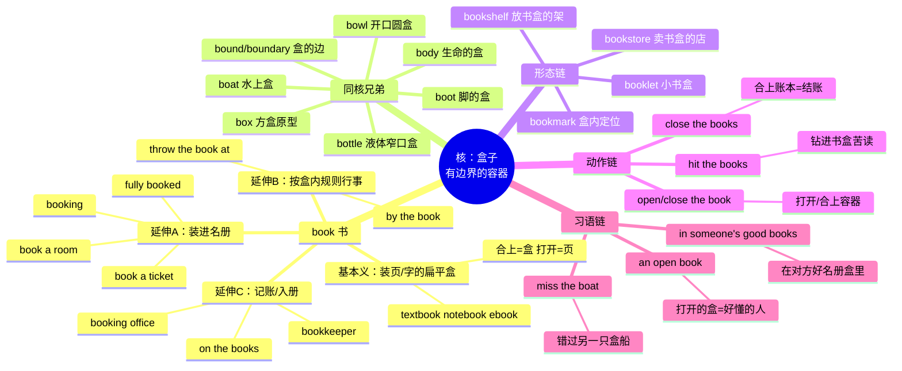

# 逻辑英语 · book 核思维导图

> 方法论：钟平「逻辑英语」风格——任一单词都不是孤立的，而是逻辑推理链条上的一个节点；链条相交即成思维导图。  
> 核公理：`bo ---- box（盒子）`——关键是音形键 **bo**；box 是意象锚点；盒子是中文释义（有边界、能装东西的空间）  
> 主节点：`book`

---

## 1. 核定义

| 项目 | 内容 |
|------|------|
| 核 | 盒子 |
| 操作定义 | 有边界、能装内容、或本身即封闭/半封闭空间 |
| book 的一句话 | 装「页 / 字」的扁平盒；合上是盒，打开是页 |
| 定位 | 教学逻辑（记忆与推理），≠ 严格历史词源 |

---

## 2. 思维导图（Mermaid）



---

## 3. 推理链大纲（可打印）

```
【核】盒子 = 有边界、能装东西的空间
    │
    ├─① 具象落地
    │     box（方盒）
    │       ├─ boat（水上的盒）
    │       ├─ bowl（开口圆盒）
    │       ├─ bottle / boot / body
    │       └─ bound / border / boundary（盒的边）
    │
    └─② 主节点 BOOK
          │
          ├─【基本义】装「页/字」的扁平盒 → 书
          │     └─ textbook / notebook / ebook / booklet
          │
          ├─【链A·装进系统盒】预约/占位
          │     book a seat / book a hotel
          │     → booking → fully booked
          │     → booking office
          │
          ├─【链B·规则盒】
          │     by the book
          │     throw the book at sb
          │
          ├─【链C·账册盒】
          │     bookkeeper / close the books / on the books
          │
          ├─【链D·关系名册盒】
          │     in sb's good/bad books
          │     an open book
          │
          └─【链E·学习动作】
                hit the books / open a new book
```

---

## 4. 节点推理表（箭头为什么成立）

| 从 → 到 | 推理一句话 |
|--------|------------|
| 盒子 → book | 合上是容器，打开见内容 → 书 |
| book → 预订 | 把位置装进「预约名册」这个盒子 |
| book → fully booked | 盒子容量满了 |
| book → by the book | 按盒子里写好的规则走 |
| book → bookkeeper | 往账本盒子里装数字的人 |
| book ↔ box/boat/bowl | 同核异形：方盒 / 水盒 / 圆盒 / 字盒 |
| book → bookmark | 在书盒里插一根位置标记 |

---

## 5. 验收造句（每链至少 1 句）

1. **基本义**：This book is a box of pages.
2. **链A**：Please book a room before the weekend.
3. **链A'**：The hotel is fully booked.
4. **链B**：Do it by the book.
5. **链C**：The accountant will close the books tomorrow.
6. **链D**：She is an open book.
7. **链E**：I need to hit the books tonight.
8. **同核对照**：The boat is a floating box; the bowl is an open box.

---

## 6. 导图读法

1. **竖看**：永远先回核「盒子」，再问「装的是什么」。
2. **横看**：同层是兄弟词（box / boat / bowl / book），不是孤立词。
3. **深看**：多义词 = 同一节点上的分叉。
4. **验收**：每个叶子节点能造 1 句；造不出则链断，需补画面。

---

## 7. 边界说明

- 本导图服务**记忆与推理**，不替代词典与词源。
- 历史词源上 book / boat / bowl / box 并非同一词根；冲突时以权威词典为准，导图标注为「教学逻辑」。
- 核不可无限扩张：塞不进「盒子」的词允许例外，勿硬拗。

---

*基于钟平逻辑英语「核意象 → 推理链 → 思维导图」方法，以 book 为主节点整理。*
